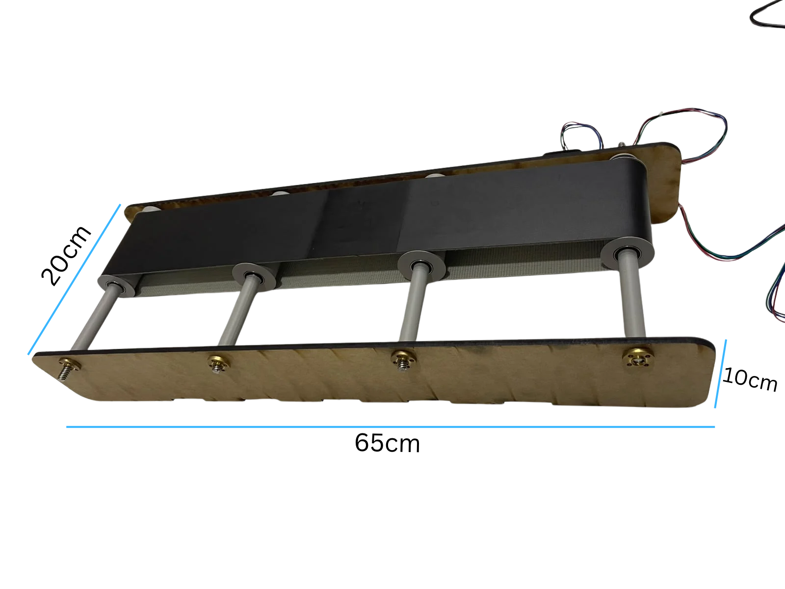
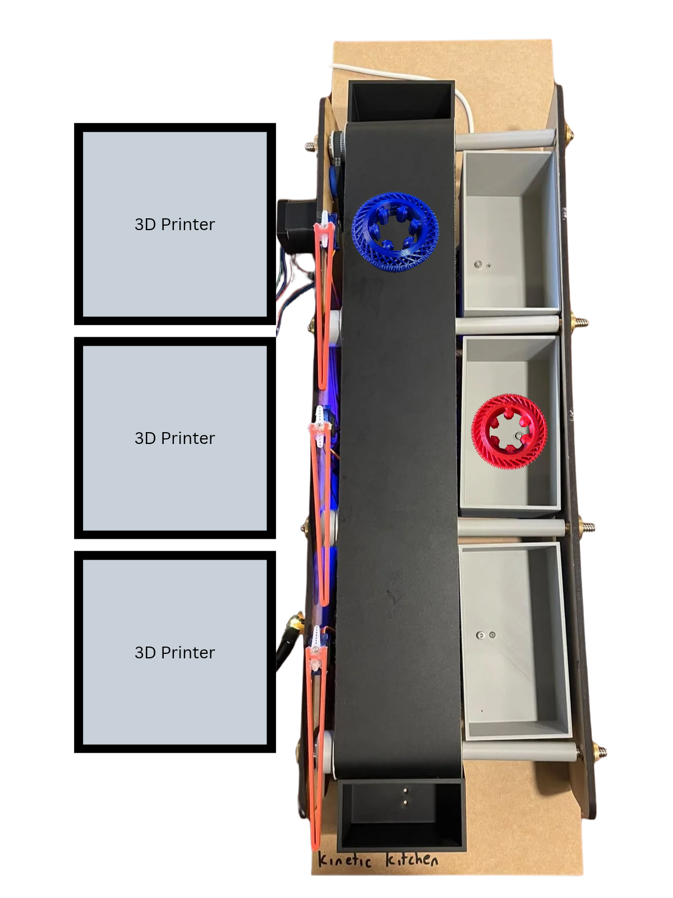
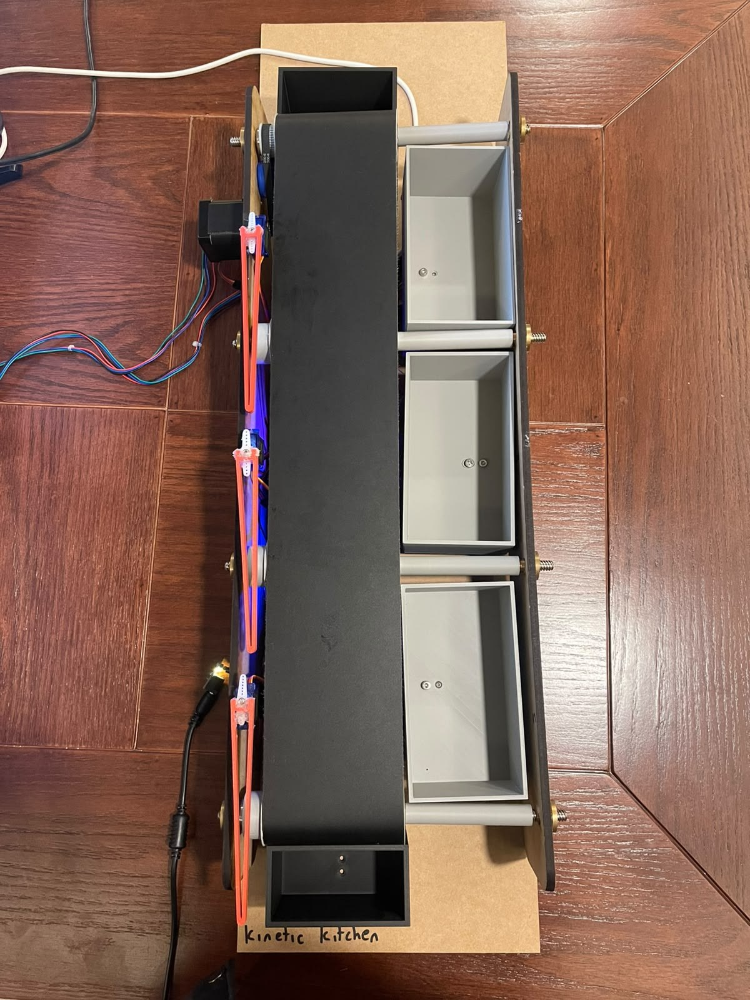
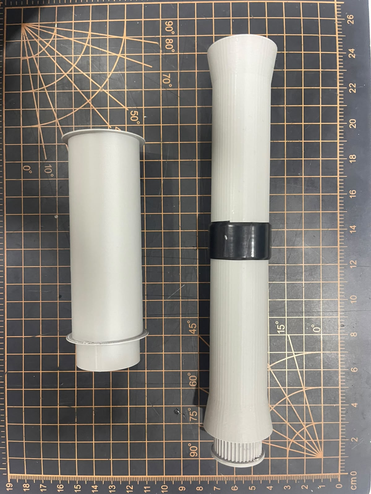
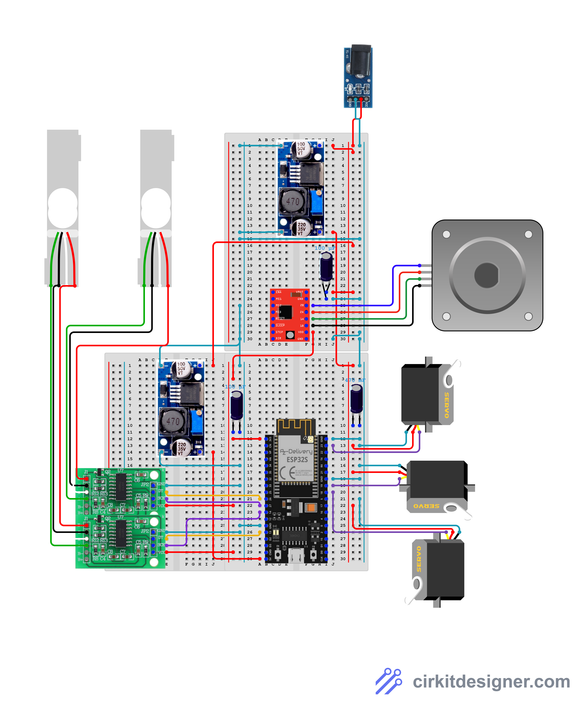

# Kinetic Kitchen: Automated Sorting and Handoff for 3D Print Farms

**Tecnológico de Monterrey, Campus Monterrey**
**School of Engineering and Sciences**
**FrED Factory Lab (Tecnológico de Monterrey and MIT collaboration)**

> Every `[TODO]` in this file is something only the team can fill in or confirm. Search for it and clear all of them before exporting to PDF.

| Item | Detail |
| :--- | :--- |
| Category | Desarrollo de Prototipo Físico |
| Attribute | Emprendimiento |
| Team | Cecil Yusei Howell (project manager), Carlos Alberto Garcia Leyva, Yoana Montoya Garza, Javier Taddeus Hernández Garza. All third-semester students: Cecil, Yoana and Javier in Mechatronics Engineering, Carlos in Mechanical Engineering. |
| Advisor | Dr. Erick Ramírez-Cedillo, Program Director, Mechatronics Engineering |
| FrED Factory project lead | Bárbara Alejandra Novau Martínez |
| Lab | FrED Factory |
| Built (prototype) | 65 cm × 20 cm × 10 cm conveyor, 3 start positions, 5 collection boxes |
| Planned (full station) | A longer conveyor in front of 3 Bambu Lab P1S printers, with 12 boxes to hold one day of prints |
| Period | Fall 2026 (Expo Ingenierías, December 1, 2026) |

---

## 1. Abstract

Print farms already automate job queues and bed clearing, but finished parts still fall into one shared bin. Parts hit each other, orders from different students get mixed, and nobody knows who picked up what. Kinetic Kitchen is a sorting station that sits in front of a row of 3D printers and sends each finished part to its own box. The full station is designed for three Bambu Lab P1S printers: a longer and wider conveyor, 12 boxes to hold one day of prints, a load cell under each box, and a message to the student with a photo of the part and the box number. This semester the team built a small prototype to prove the routing. It is a 65 cm conveyor made from laser-cut MDF, 3D printed rollers, a NEMA 17 stepper motor, and an ESP32. It has three start positions, which stand in for the three printers, and five boxes. Two boxes are at the ends of the belt, and the belt reaches them by running forward or backward. Three boxes are along the side, and a servo arm set at 45° pushes the part off the belt into each one. Two boxes sit on load cells, so the system knows when a box is occupied and when it is vacant again. A web page lets the user choose a start position and a box and shows box status. `[TODO: one sentence with the real test results once they exist. Do not submit numbers that were not measured.]`

**Keywords:** 3D print farm, part sorting, conveyor, stepper motor, load cell, ESP32, Bambu Lab P1S, FrED Factory

---

## 2. Introduction

Fast desktop printers and automatic bed clearing let a small lab run prints back to back with nobody present. In the FrED Factory Lab, the B.L.A.Z.E. team (Bambu Lab Automated Zero-Touch Executor) is building a system where students upload files to an online queue and the printers remove finished parts on their own. The physical side after that is not solved. Once a part is pushed off the bed, it lands in a bin with everyone else's parts.

Kinetic Kitchen covers that last step. It takes the part after it leaves the printer, moves it to a box assigned to that job, and records that the box is taken until someone removes the part. The goal is for picking up a print to work like picking up a takeout order.

---

## 3. General Context

FrED stands for Fiber Extrusion Device, a low-cost desktop machine that MIT designed to teach manufacturing. The FrED Factory at MIT is a small production facility that builds these devices and is also used for teaching and research (MIT FrED Factory, n.d.). MIT and Tec de Monterrey run the program together, and FrED factories now operate at MIT and at Tec's Monterrey and Mexico City campuses (DiCristofaro, 2026).

Kinetic Kitchen is a student project in the FrED Factory Lab at Campus Monterrey. It was accepted under the lab's research area "Building the Task Force of the Future", which looks at new physical and intelligent systems for manufacturing (FrED Factory Lab, n.d.).

The lab runs Bambu Lab P1S printers that many students share. B.L.A.Z.E., another project in the lab, automates what happens between prints (B.L.A.Z.E. team, 2026a, 2026b):

* **Hardware.** A door actuator, a build plate actuator, and a pusher on the extruder remove the part. The printer sits on inclined feet. An infrared sensor confirms that the bed is clear before the next job.
* **Control.** A Raspberry Pi 5 coordinates the printers over MQTT without modifying them.
* **Web queue.** Students log in with a tec.mx account and upload a file. The system stores who sent each job, which printer ran it, and when it finished, and it shows notifications in the app.

B.L.A.Z.E. ends when the part leaves the printer. Kinetic Kitchen picks up from there.

Shared labs like this are common. The Fab Foundation alone lists more than 1,500 fab labs in over 90 countries (Fab Foundation, n.d.), and that count does not include university makerspaces outside its network. These labs need a handoff system that is cheap, safe to have around students, and easy to maintain. Industrial sorting equipment does not fit that description.

---

## 4. Scope

The project has two parts: the full station, which is the actual product, and the prototype, which is what was built this semester. The rest of this report labels each section or number as one or the other.

| | Built: prototype (Fall 2026) | Planned: full station (2027 to 2028) |
| :--- | :--- | :--- |
| Purpose | Prove the routing and the box sensing | Serve the FrED Factory printers every day |
| Printers | None connected. 3 start positions stand in for them. | 3 Bambu Lab P1S (389 mm each, about 1.25 m span), with B.L.A.Z.E. installed |
| Conveyor | 65 cm long, 10 cm wide belt | About 2.8 m long, 30 cm wide belt (section 15.2) |
| Boxes | 5 | 12, enough for one day of prints |
| Weight sensing | Load cells under 2 boxes, used to tell occupied from vacant | Load cell under every box, also checked against the slicer weight |
| Arms | 3, SG90 servos, 14 cm | 10, MG996R servos with a tip stop, about 42 cm |
| Part weight | 10 g to 250 g | 10 g to 500 g |
| How a route starts | User picks start and box on a web page | "Bed cleared" signal from B.L.A.Z.E. |
| How parts get on the belt | Placed by hand | Ejected by the printer (B.L.A.Z.E. team) |
| Photo and message to the student | No | Yes |
| Frame | 5.5 mm MDF, chosen because it is cheap and fast to cut | Metal |

Weight sensing is in scope for both. It is how the system knows whether a box is occupied or vacant.

Out of scope for both versions this year: locked boxes and user ID at pickup.

**Why the prototype is smaller.** Three P1S printers side by side span about 1.25 m, and the full station also needs room for 12 boxes and a belt wide enough to catch falling parts. The prototype is a cheap, small version with a 10 cm belt. It tests routing and sensing but not the catch. Section 7.5 shows that the same design holds at full size.

---

## 5. Problem Statement

When several users share printers with automatic ejection and one drop bin, four problems show up:

1. **Damage.** Parts fall onto earlier parts. Thin walls crack and surfaces get scratched.
2. **Mixed orders.** Students dig through a pile to find the right print, and sometimes take the wrong one.
3. **No record.** Nothing confirms that a part reached a bin or when it was picked up.
4. **Cost of the alternatives.** A robot arm can do this job, but a new UR5e costs about $30,000 to $45,000 USD, and a full cell with gripper and setup often costs $40,000 to $150,000 USD (Standard Bots, 2024).

### 5.1 Research Questions

**Main question:** Can a small conveyor with 45° servo arms and a reversible belt send a part from any start position to any assigned box reliably?

**Sub-questions:**

1. Do the 45° arms push parts of different shapes and weights off the belt without jamming?
2. How long does each route take?
3. Do the load cells correctly show when a box is taken and when it is free again?
4. How much power does the station use while waiting and while running?

---

## 6. Justification

1. **Five boxes with three servos.** The belt runs both ways, so the two end boxes need no arm. A part just rides off the end. Only the three side boxes need a servo.
2. **No optical sensors on the belt.** Infrared sensors give false readings with room light, dust, and translucent filament. The start of each route comes from a command, and arrival is confirmed by weight.
3. **Pushing instead of gripping.** Printed parts come in any shape. An arm that pushes does not need to know the shape. A gripper does.
4. **Motor off between prints.** Prints take hours. The stepper driver is disabled between jobs so the motor draws no current while waiting.
5. **Cheap, common parts.** MDF, printed PLA, a stepper, hobby servos, and an ESP32. A lab can repair it with what it already has.

---

## 7. Theoretical Framework

Conveyors that divert items with an angled arm are common in packaging and warehouse lines. Hobby versions with a stepper motor and a microcontroller are common too ("How to make a DIY belt conveyor," 2022). A robot arm can also sort printed parts, but it costs far more (section 5). Printed parts come in any shape, so a fixed angled arm that pushes the part is the simplest option. It does not need to grip anything.

Most numbers in this section are calculated from the design, not measured. Values marked "assumed" need to be checked on the prototype.

### 7.1 Arm Deflection

The belt moves at speed v. The arm sits at θ = 45° to the belt direction. A part that reaches the arm slides along it while the belt keeps pushing it forward. With a friction coefficient μ between the part and the arm, the speed along the arm is:

v_arm = v (cos θ − μ sin θ)

The sideways part of that speed is:

v_side = v_arm sin θ = v sin θ cos θ (1 − μ tan θ)

With v = 150 mm/s (the design value, set in firmware as shown in 7.2) and μ ≈ 0.25 (assumed):

| Quantity | Value |
| :--- | :--- |
| Arm length | 140 mm |
| Belt width the arm covers at 45° | 99 mm |
| Sideways speed of the part | 56 mm/s |
| Time to cross 100 mm of belt | 1.8 s |
| Angle where the part stops sliding (tan θ = 1/μ) | 76° |

The 45° setting is far from the 76° limit, so parts should slide and not wedge.

**Servo check.** The belt pushes the part against the arm with at most the belt-to-part friction force. With a belt friction coefficient of 0.5 (assumed), the worst case is the part pressing on the arm tip, 140 mm from the servo.

| Part mass | Torque needed at the tip | SG90 (about 0.18 N·m) | MG996R (about 0.92 N·m) |
| :--- | :--- | :--- | :--- |
| 250 g | 0.17 N·m | At its limit | Safety factor 5.4 |
| 500 g | 0.34 N·m | Not enough | Safety factor 2.7 |

The prototype uses SG90 servos, which limits it to parts of about 250 g. The full station will use the MG996R servos the team already has.

### 7.2 Motor and Drive

The NEMA 17 (17HS4401) is rated for 40 N·cm of holding torque at 1.7 A. Holding torque is the value at standstill, so it cannot be used as running torque. A fair estimate for usable torque at low speed is about half, 20 N·cm. The motor is driven by a A4988 driver from the 12 V supply `[TODO: current limit and microstep setting]`.

The motor drives the end roller through a GT2 timing belt (2 mm pitch, 6 mm wide, 200 mm loop) with a 20-tooth pulley from the kit on the motor and a 40-tooth pulley printed in PLA on the roller rod, a 2:1 reduction. The kit's 36-tooth pulley was not used. The end rollers are 30 mm in diameter. The conveyor belt loop is 120 cm, which puts the end roller centers about 553 mm apart. At 150 mm/s the roller turns at about 95 RPM and the motor at about 191 RPM.

**Belt speed.** A stepper motor turns a fixed angle per step, so belt speed is set by the step rate the ESP32 sends, the pulley ratio, and the roller diameter. Motor torque does not set the speed. It only decides whether the motor can hold that speed under load, which is the check in the table below.

v = π × D × (f / (200 × m)) × (20 / 40)

Here D is the roller diameter (30 mm), f is the step rate in steps per second, 200 is the motor's steps per turn, and m is the microstep setting of the driver.

| Microstep setting | Step rate for 150 mm/s |
| :--- | :--- |
| Full step (m = 1) | 637 steps/s |
| 1/8 (m = 8) | 5,093 steps/s |
| 1/16 (m = 16) | 10,186 steps/s |

The belt is 2 mm thick and rides on the outside of the roller, so the real speed will be a few percent higher than this formula gives. The belt speed test in 14.1 checks it.

| Step | Calculation | Result |
| :--- | :--- | :--- |
| Usable motor torque | 0.5 × 40 N·cm | 20 N·cm |
| Torque at roller | 20 × 2 × 0.95 (timing belt efficiency) | 38 N·cm |
| Belt pull | 38 N·cm / 1.5 cm | 25.3 N |
| Load to move | 0.65 kg (top run of belt plus a 500 g part) × 9.81 × 0.35 | 2.2 N |
| Margin | 25.3 / 2.2 | about 11 |

The load figure is on the safe side, because the belt rides on rollers and does not drag on a deck. The motor is not the limit. The more likely failure is the drive roller slipping on the belt, which depends on belt tension.

**Support rollers.** Two rollers sit between the end rollers so the belt does not sag under a part. They are 35 mm in diameter, 5 mm larger than the end rollers. With four equal rollers the belt did not touch the middle two. The larger middle rollers push up into the belt, which gives contact and the right tension.

**Belt tracking.** The first prototype used cone-shaped roller ends to center the belt. The belt slowly climbed the cones and drifted. The current rollers have flat flanges that are too tall for the belt to climb, and the belt now stays in place.

### 7.3 Box Sensing

Boxes 2 and 4 each sit on a 1 kg bar load cell. The load cell is a strain-gauge bridge read by an HX711 amplifier, which sends readings to the ESP32 over a clock line and a data line. Noise limits the useful resolution to roughly 1 g on this type of cell.

In the prototype the load cells answer one question: is the box occupied or vacant?

* **Occupied:** the reading stays above 3 g for 1 s.
* **Vacant:** the reading stays below 2 g for 2 s. The box is re-zeroed each time it is marked vacant, because load cells drift with temperature.

`[TODO: set these thresholds from real readings.]`

In the full station every box has a load cell, and the measured weight will also be compared with the slicer's estimate to confirm that the right part arrived. The planned tolerance is the larger of 5 g or 5% of the estimate. A flat 5 g tolerance is too loose for a 10 g part and too tight for a 500 g part.

### 7.4 Timing and Power

Calculated at 150 mm/s, with the part at the far edge of the belt and 1.5 s for the weight reading to settle:

| Route | Belt travel | Crossing | Settle | Total |
| :--- | :--- | :--- | :--- | :--- |
| Start 1 to box 2 (right beside it) | 0 s | 1.8 s | 1.5 s | 3.3 s |
| Start 1 to box 4 (about 369 mm) | 2.5 s | 1.8 s | 1.5 s | 5.7 s |
| Start 1 to box 5 (off the far end, about 476 mm) | 3.2 s | none | none | 3.2 s |

The longest route is about 5.7 s. The target is 8 s for any route, and the firmware stops the belt if a route takes more than 10 s.

**Power.** The motor draws nothing when the driver is disabled. The ESP32 has to stay on Wi-Fi and keep reading the load cells, and the buck converter and idle servos also draw current. A rough estimate for standby is 0.5 W to 1 W. `[TODO: measure standby and running power with the USB power meter and multimeter.]`

### 7.5 Scaling to the Full Station

The same formulas were applied to the full station proposed in section 15.2: a conveyor about 2.8 m long, a 30 cm belt, 50 mm rollers, a 3:1 reduction, and MG996R servos. All numbers below are calculated.

| | Prototype (built) | Full station (planned) |
| :--- | :--- | :--- |
| Arm length to cover the belt at 45° | 140 mm | 424 mm |
| Heaviest part | 250 g | 500 g |
| Torque on the servo at the heaviest part, load at the arm tip | 0.17 N·m against 0.18 N·m (SG90) | 1.04 N·m against 0.92 N·m (MG996R) |
| Belt pull against load | 25.3 N against 2.2 N | 22.8 N against 9.2 N |
| Motor margin | about 11 | about 2.5 |
| Route to the nearest box | 3.3 s | 6.8 s |
| Longest route | 5.7 s | 18.1 s |
| Route time target and timeout | 8 s and 10 s | 20 s and 25 s |

What this shows:

* **Servo.** The servo is the weak point in both versions. At full size the MG996R cannot hold a 500 g part at the arm tip on its own. A fixed stop at the arm tip, so the stop takes the push and not the servo, is required.
* **Motor.** The same NEMA 17 still works, but the margin drops to about 2.5 with the cautious friction value used here. If testing shows less, the options are a larger motor or a lower belt speed.
* **Time.** Routes are longer, but a print takes hours, so 18 s to deliver it does not matter. The time only limits how fast parts can be cleared when several printers finish together.

---

## 8. Objectives

### 8.1 General Objective

Design, build, and test a conveyor prototype that sends a part from any of three start positions to any of five boxes and detects when a box is taken or free, by December 1, 2026.

### 8.2 Specific Objectives

1. **Mechanical.** Build a 65 cm × 20 cm × 10 cm conveyor with laser-cut MDF side plates, four printed rollers on threaded rod, three printed 14 cm arms, and five boxes.
2. **Electronics.** Connect an ESP32 to an A4988 stepper driver, three servos, two 5 V buck converters, and two HX711 load cell amplifiers.
3. **Software.** Write ESP32 firmware and a simple web page that takes a start position and a box, runs the route, and shows which boxes are taken.
4. **Testing.** Measure routing success, route time, box detection, and power (section 14).
5. **Plan the full system.** Define how the station will connect to B.L.A.Z.E. and the printers.

---

## 9. Hypothesis

The prototype, a reversible conveyor with three 45° servo arms, can send parts from 10 g to 250 g from any of three start positions to any of five boxes with at least 98% success, in under 8 s per route, using parts that cost under 1% of a robot arm cell.

---

## 10. Methodology

Each subsystem is tested alone before it is combined with the others.

| Stage | Dates | Work | Status on Nov 10 |
| :--- | :--- | :--- | :--- |
| 1. Mechanical build | Oct 1 to Oct 24 | Laser cut the frame, print rollers and arms, mount the motor and belt | Done. The belt runs. |
| 2. Wiring and firmware | Oct 25 to Nov 4 | Servos, load cells, ESP32 firmware, boxes | In progress `[TODO: update]` |
| 3. Testing | Nov 5 to Nov 16 | Tests in section 14 | Not started `[TODO: update]` |
| 4. Final touches | Nov 17 to Nov 23 | Wire cleanup, electronics housing, box labels | |
| 5. Expo preparation | Nov 24 to Nov 30 | Poster, video, pitch practice | |

The report upload closes on November 20, so the tests have to be finished and written up before that date.

### 10.1 Design History

The first concept (September) was a catch carriage or chutes under the printers that fed lockers opened by a QR code. The team dropped it for a conveyor with servo arms and open boxes. The conveyor has fewer moving parts, needs no locks or scanner, and could be built with parts already in the lab.

| Part | Version | What happened |
| :--- | :--- | :--- |
| Chassis | V1 | Tolerance problems in the structure. |
| Chassis | V2 | Unstable, and the belt did not fit once the bearings and rods were in. |
| Chassis | **V3 (current)** | 65 cm × 20 cm × 10 cm, 5.5 mm MDF. One 10 cm belt, with the boxes in the remaining 10 cm of width to keep the prototype compact. |
| Rollers | V1 | Cone-shaped ends to center the belt. The belt climbed the cones and drifted. With four equal rollers the belt did not touch the middle two, and it was over-tensioned, so the motor struggled. |
| Rollers | **Final (current, October 27)** | Flat flanges fixed the drift. End rollers are 30 mm and middle rollers are 35 mm, which fixed the contact and the tension. |
| Roller pulley | Kit pulley, 36 teeth | Not used. |
| Roller pulley | **Printed, 40 teeth (current)** | Printed in PLA directly on the roller rod, for a 2:1 reduction. |
| Arm | First version | Bad tolerances, used a lot of filament, and too heavy for the servo. |
| Arm | 3.0 | Failed. At 13 cm it was too short to cover the belt, and the connection to the servo had bad tolerances. |
| Arm | **Current** `[TODO: version number]` | 14 cm long, with a corrected servo connection. |
| Box | 1.0 | Too small. |
| Box | **Current** `[TODO: version number]` | Re-dimensioned to fit the spaces in the chassis. |

The old and new rollers are compared side by side in Figure 4 (section 17). The new roller has flat flanges and no cone. The first roller was 20 cm long. The new one is shorter because it only needs to span the 10 cm belt plus the flanges.

### 10.2 Prototype Layout

*Figure 1. The prototype: 65 cm long, 20 cm wide, 10 cm tall.*

*Figure 2. Demo layout. Green circles are the three start positions. Gray blocks show where the P1S printers would sit. Red blocks are the five boxes. Boxes 2 and 4 have load cells.*

### 10.3 Prototype Sequence

1. **Choose.** The user picks a start position and a box on the web page.
2. **Set the arm.** For box 2, 3, or 4, the ESP32 swings that box's arm out to 45°. For box 1 or 5, all arms stay in.
3. **Move.** The ESP32 enables the stepper driver and runs the belt toward the chosen box. The part rides the belt until it meets the arm and slides off into the box, or rides off the end.
4. **Stop.** The belt stops when the load cell shows the part has landed (boxes 2 and 4) or after the set run time (boxes 1, 3, and 5). If nothing is confirmed within 10 s, the belt stops and the page shows an error.
5. **Status.** The page shows boxes 2 and 4 as taken until the weight returns to near zero.

### 10.4 Full System Sequence (planned)

1. The print finishes. The backend saves a photo from the printer's built-in camera while the part is still on the bed.
2. B.L.A.Z.E. opens the door, pushes the part out, and confirms with its sensor that the bed is clear.
3. The backend picks a free box and sends the route to the ESP32.
4. The station delivers the part and checks its weight against the slicer estimate.
5. The student gets a message with the box number and the photo.
6. When the weight returns to zero, the box is free again.

Two cases the full system has to handle:

* **Two prints finish at the same time.** Only one part is on the belt at a time. Jobs go into a queue, and the second printer keeps its part on the bed until the belt is free.
* **The part does not arrive or the weight is wrong.** The belt stops, the box is marked "needs checking" and is not given to another job, and lab staff get an alert. The system does not retry on its own.

**What B.L.A.Z.E. already provides, and what it does not.** This comes from reading their code and pitch (B.L.A.Z.E. team, 2026a, 2026b).

| Kinetic Kitchen needs | In B.L.A.Z.E. today | Plan |
| :--- | :--- | :--- |
| Which printer finished and whose job it was | Yes. The job record has the user, the printer, and the finish time. | Read it from their system. |
| A signal that the part has left the bed | Not yet. Their code treats "print finished" as "printer free" until the bed sensor is added. | Use their infrared bed-clear sensor once it is installed. `[TODO: agree with B.L.A.Z.E. on how Kinetic Kitchen receives this event.]` |
| A way to tell the student | Yes. In-app notifications for failed and waiting jobs. | Add a "ready in box N" notification to their app. A separate Discord bot is not needed. |
| Expected part weight | No. Jobs store the file, not the weight. | Read the weight from the sliced .3mf file they store. If that fails, the load cell is used only for occupied or vacant. |
| Photo of the finished part | No. | Open. The printer camera is not part of their system. |

---

## 11. Techniques and Tools

### 11.1 Mechanical

* **Frame.** Two laser-cut side plates of 5.5 mm MDF, 65 cm × 10 cm, held apart by four M8 threaded steel rods that also work as the roller axles.
* **Rollers.** Four rollers printed in PLA, on eight ball bearings with an 8 mm bore, to fit the rod. The bearings are about 21 mm across, which is consistent with standard 608 bearings (8 × 22 mm). The rollers have flat flanges to keep the belt in place. The two end rollers are 30 mm in diameter and the two middle rollers are 35 mm.
* **Belt.** A ready-made conveyor loop, 120 cm around, 10 cm wide, and 2 mm thick. It came from FrED Factory stock.
* **Arms.** Printed in PLA, 14 cm long, one on each SG90 servo.
* **Boxes.** Five boxes printed in PLA `[TODO: dimensions]`. Boxes 2 and 4 rest on load cells.

### 11.2 Electronics

* **Power.** A 12 V 3 A adapter feeds the stepper driver directly. The circuit is built on three half-size breadboards with these power rails: 12 V from the DC jack (top right), 5 V for the three servos (bottom right), 3.3 V (bottom middle), and one rail with only ground connected (top middle). The bottom-left rail is unused. The first LM2596 steps the 12 V rail down to 5 V and feeds the servo rail. The second LM2596 takes 12 V from the same rail and feeds the ESP32's 5 V pin directly. The ESP32's USB-C port is only used to flash the firmware.
* **Motor driver.** A4988 in step and direction mode.
* **Controller.** ESP32 WROOM-32.
* **Safety.** The prototype has no fuse and no emergency stop button. The firmware has a 10 s timeout, and unplugging the 12 V adapter stops everything. Adding a stop button and a fuse before the Expo is step A1 of the improvement plan (15.1).

The circuit diagram is in Figure 5 (section 17). It was drawn in Cirkit Designer (https://app.cirkitdesigner.com/project/a55b3d68-53eb-42b1-83a7-80fec2e8fb32), and the project file is saved in the team folder as `circuit/Kinetic_Kitchen_Prototype.ckt`. The diagram uses these parts:

| Part | Qty | Role |
| :--- | :--- | :--- |
| NEMA 17 stepper motor | 1 | Moves the belt. Four wires (A+, A-, B+, B-) go to the driver. |
| A4988 stepper driver | 1 | Step and direction control for the motor. |
| ESP32 development board (ESP32S NodeMCU) | 1 | Controller. |
| LM2596 buck converter | 2 | Step 12 V down to 5 V. The first feeds the 5 V servo rail. The second feeds the ESP32 5 V pin. |
| DC jack breakout | 1 | 12 V input from the adapter. |
| HX711 load cell amplifier | 2 | One per load cell. |
| 1 kg load cell | 2 | Under boxes 2 and 4. |
| Servo (SG90 in the build) | 3 | One per side arm. |
| Electrolytic capacitor, 100 µF | 2 | Supply smoothing. |
| Electrolytic capacitor, 470 µF | 1 | Supply smoothing. |
| Breadboard, half size | 3 | Hold the wiring. |

`[TODO: confirm the capacitor roles.]`

### 11.3 Software

* **Firmware.** C++ on the ESP32. It steps the motor, moves the servos, reads the load cells, and serves the web page.
* **Web page.** Two inputs (start position and box), a run button, a stop button, and the status of boxes 2 and 4. The page is stored inside the firmware and served by the ESP32, so there is no separate server.
* **Code location.** Firmware and web page are in one repository, `firmware/Kinetic_Kitchen`, built with ESP-IDF. `[TODO: add the GitHub link once the repository is public or shared with the advisor.]` The README lists the pin map, the HTTP API, and the values still to be measured.
* **Current state.** The code runs in simulation mode because the electronics are not wired yet. The load cells are faked in software until the HX711 boards are connected.

---

## 12. Infrastructure

The work is done in the FrED Factory Lab and the campus makerspaces:

* Bambu Lab P1S printers (used to print the rollers and arms).
* Laser cutter for the MDF.
* Electronics benches: scales, multimeters, a USB power meter, and soldering stations.

---

## 13. Resources

The prototype was built as cheaply as possible. Most parts came from FrED Factory stock, and the team only bought four items.

| # | Item | Used | List price (MXN) | Source |
| :---: | :--- | :--- | ---: | :--- |
| 1 | MDF panel, 5.5 mm, 1.22 × 2.44 m | 20 cm × 65 cm | 274 | Bought |
| 2 | SG90 servo, 5-pack | 3 | 181 | FrED Factory |
| 3 | 12 V 3 A power adapter | 1 | 128 | FrED Factory |
| 4 | ESP32 WROOM-32 | 1 | 150 | FrED Factory |
| 5 | 1 kg load cell with HX711, 2-pack | 2 | 107 | FrED Factory |
| 6 | A4988 stepper driver | 1 | 142 `[TODO: confirm A4988 price]` | FrED Factory |
| 7 | NEMA 17 stepper 17HS4401 | 1 | 185 | FrED Factory |
| 8 | GT2 pulley kit (20T and 36T) with 200 mm × 6 mm belt | 1 | 86 | Bought |
| 9 | Washers | 8 | 30 | FrED Factory |
| 10 | Threaded steel rod, M8 | 4 | 119 (estimate) | FrED Factory |
| 11 | Ball bearings, 8 mm bore | 8 | 136 (estimate) | FrED Factory |
| 12 | Conveyor belt loop, 120 cm × 10 cm × 2 mm | 1 | 800 (estimate) | FrED Factory |
| 13 | PLA filament, 1 kg roll | about 1/3 roll | 288 | FrED Factory |
| 14 | LM2596 buck converter, 2-pack | 2 | 125 | FrED Factory |
| 15 | Hot glue gun sticks | 1 | 50 (estimate) | Bought |
| 16 | Barrel DC jack breakout, 5-pack | 1 | 165 | Bought |
| | **Total at list price** | | **2,966** | |
| | **Paid by the team** | | **575** | Items 1, 8, 15, 16 |

At 20 MXN per USD, the list price total is about $148 USD. The belt came from lab stock and could not be found for sale online, so its $800 MXN is an estimate. Prices for items 10 and 11 come from listings of similar parts, not from receipts. The price of the glue sticks was not recorded, so $50 MXN is an estimate. List prices are for full packs, so the cost of the material actually used is lower.

The full station has not been costed yet. The first purchase list, for a smaller 1.3 m MDF design (September 30), added up to $4,128 MXN, about $206 USD. The full station in section 15.2 is longer, has a metal frame, a wider belt, and more boxes, so it will cost more. Costing it is step C1 of the plan in section 15.1.

---

## 14. Results

`[TODO: this whole section needs real data. Nothing has been tested yet.]`

### 14.1 Tests

1. **Routing test.** Place a part at a start position, choose a box, and record whether it arrives. There are 15 routes (3 starts × 5 boxes). Ten runs per route gives 150 runs.
2. **Part variety.** Repeat a smaller set of runs with different shapes and weights (block, cylinder, flat part, thin part, something round).
3. **Route time.** Time each of the 15 routes.
4. **Box detection.** Place and remove a part in boxes 2 and 4, 20 times each. Record whether the page shows the right status.
5. **Weight accuracy.** Compare the load cell reading with a lab scale for several known weights.
6. **Belt.** Measure belt speed. Run the belt for 30 minutes and check for drift and slipping.
7. **Arm load.** Find the heaviest part the arm can push without being forced back.
8. **Power.** Measure standby and running power.
9. **Drop.** Drop parts onto the belt from a few heights and record whether they stay on.

Why 150 runs: with zero failures, 50 runs only shows the true success rate is above about 94%. It takes about 150 clean runs to back up a 98% claim.

### 14.2 Results Table

| Measurement | Target | Result |
| :--- | :--- | :--- |
| Parts delivered to the chosen box | ≥ 98% of 150 runs | `[TODO]` |
| Route time, longest route | ≤ 8 s | `[TODO]` |
| Box shown as taken after a part lands | 40 of 40 | `[TODO]` |
| Box shown as free after pickup | 40 of 40 | `[TODO]` |
| Weight error against a lab scale | ≤ 5 g | `[TODO]` |
| Belt speed | 150 mm/s | `[TODO]` |
| Belt drift after 30 minutes | none visible | `[TODO]` |
| Heaviest part the arm can push | ≥ 250 g | `[TODO]` |
| Standby power | ≤ 1.5 W | `[TODO]` |
| Running power | ≤ 25 W | `[TODO]` |

Report failures and what caused them. A table with two jams and an explanation is more believable than one where everything passes.

### 14.3 Entrepreneurship Impact

1. **Problem and opportunity.** Labs that automate bed clearing still sort parts by hand. Parts get damaged and mixed, and time goes to finding prints. Kinetic Kitchen sorts each part into its own box and shows which boxes are taken.
2. **Short-term users.** First, the students and staff who use the FrED Factory printers, together with the B.L.A.Z.E. team. Next, the university makerspace if the FrED Factory trial goes well. After that, other university labs and small print farms that run several Bambu Lab printers.
3. **Can it be sold.** Yes, as a kit. The station uses laser-cut sheet, printed parts, and common electronics. The prototype's parts cost about $3,000 MXN at list price, and an earlier estimate for a smaller full-size design in MDF was about $4,100 MXN. A kit price of about $9,900 MXN (about $495 USD) would cover parts, cutting, printing, and assembly time, and leave a margin of roughly half the price. This price is a first estimate and will be updated once the metal version is costed (section 15.1, step C1).
4. **Difference from existing options.**

| Option | What it does | Cost | Sorts parts by user |
| :--- | :--- | :--- | :--- |
| 3DQue AutoFarm3D with door opener | Opens the printer door and pushes the part off the bed | $129 USD per printer for the door opener, software from $9.99 USD per month (Tom's Hardware, 2025) | No |
| FarmLoop with SimplyPrint | Push-off bed clearing for Bambu Lab printers | Free during beta, paid later (SimplyPrint, n.d.) | No |
| Robot arm cell | Picks the part and places it anywhere | $40,000 to $150,000 USD (Standard Bots, 2024) | Yes |
| Kinetic Kitchen | Routes each part to its own box and tracks the box | About $148 USD in parts for the prototype. The full station is not costed yet (15.1, step C1) | Yes |

The ejection products are not direct competitors. They get the part off the bed, and Kinetic Kitchen handles what happens next. The only current product that sorts by user is a robot arm, at roughly 200 times the cost.

**Known limits:**

* The boxes are open. The system knows when a part is removed, but not who removed it.
* The prototype belt is too narrow to catch a part pushed out of a printer, so test parts are placed by hand.
* Small round parts can roll off the belt. Side guides are needed.

---

## 15. Conclusions

`[TODO: rewrite after testing. Conclusions have to come from the measured results in 14.2.]`

What can be said from the build so far:

1. The conveyor works mechanically. The belt runs, and replacing the cone roller ends with flat flanges fixed the drift seen in the first prototype.
2. Making the middle rollers 5 mm larger than the end rollers was needed for the belt to touch them.
3. A reversible belt gives five destinations with only three servos.
4. By calculation the motor has about 11 times the pull the prototype needs and about 2.5 times what the full station needs. The weak point in both is the arm servo.
5. The longest prototype route should take under 6 s at 150 mm/s.

### 15.1 Improvement Plan

Each improvement below comes from a weakness found in this report. They are ordered so that safety comes first, then the changes that make the test results trustworthy, then the work that has to be settled before the full station is built.

**Phase A: next semester (February to June 2027)**

| # | Improvement | Why | How | Done when |
| :--- | :--- | :--- | :--- | :--- |
| A1 | Stop button, power switch, and fuse | Visitors will stand next to a moving belt and arms, and the prototype has no way to stop except unplugging it (11.2). | A latching stop button and an inline fuse on the 12 V line. | Pressing the button stops the belt and arms within 1 s. |
| A2 | Side guides on the belt | Round parts roll off the open edge (14.3). A part that falls off counts as a failed route. | Printed or MDF strips along the open edge, with gaps only at boxes 2, 3, and 4. | No part leaves the belt except into a box during the 150-run test. |
| A3 | Stop at the arm tip | The SG90 is at its limit with a 250 g part (7.1). If the arm gets pushed back, the part misses the box. | A fixed post where the arm tip rests at 45°, so the belt's push goes into the frame and not the servo. | The arm holds a 250 g part without moving back. |
| A4 | Test logging in the firmware | Results have to be measured, not estimated. Logging by hand for 150 runs invites mistakes. | The ESP32 records route, start and stop time, and load cell readings for each run, and the web page exports them. | Every run in 14.1 has a log line. |

**Phase B: 2027 Fall semester (August to December 2027). Connect to B.L.A.Z.E. and settle the geometry, still on the prototype.**

| # | Improvement | Why | How | Done when |
| :--- | :--- | :--- | :--- | :--- |
| B1 | Connection to B.L.A.Z.E. | The station should start a route when a part leaves the bed, not when someone clicks a button. Their bed-clear signal is not built yet, so both teams have to agree on it early (10.4). | Take the printer, job, and user from the B.L.A.Z.E. job record and start the route on its bed-clear signal. Queue the jobs and allow one part on the belt at a time. | A real print ends up in a prototype box with no human input. |
| B2 | Student message | The student needs to know which box to go to. | Add a "ready in box N" notification to the B.L.A.Z.E. app. Add the printer camera photo if a way to pull it is found. | The student gets the message within 30 s of delivery. |
| B3 | Catch test with a real printer | The prototype has only been tested with parts placed by hand. How a part leaves a B.L.A.Z.E. printer sets the belt width, belt height, and side guides. | Put the prototype in front of one printer with B.L.A.Z.E. installed and record where and how parts land. | Landing zone, drop height, and bounce are measured for at least 30 parts. |
| B4 | Box geometry | Box 1.0 was too small. The box has to fit the largest part, sit on a load cell, and let the part slide in without bouncing out. | Redesign and test the box, its ramp, and its padding with parts of different sizes. | A box design that accepts the largest part a P1S can print. |
| B5 | Arm and servo | The arm is the weak point (7.5). Arm 3.0 failed on length and on its servo connection. | Test a longer arm with a tip stop and an MG996R on the prototype. | The arm holds a 500 g part without moving back. |
| B6 | Load cells on all five boxes, with weight check | Box status only works for boxes with a load cell, and the weight check confirms the right part arrived (7.3). | Add three more load cells. Read the expected weight from the sliced file that B.L.A.Z.E. stores. | Every box shows occupied or vacant, and a wrong-weight part is flagged. |
| B7 | Final dimensions | The full station should not be built on guesses. | Use the results of B3 to B5 to fix the length, belt width, and box size in 15.2. | A dimensioned drawing of the full station. |

**Phase C: full station (2028)**

| # | Step | Why | Done when |
| :--- | :--- | :--- | :--- |
| C1 | Cost the full station | The entrepreneurship case needs a real price (14.3). | A full BOM and a kit price that covers parts, labor, and support. |
| C2 | Build the full station (15.2) | This is the actual product. | All 12 boxes can be reached from all 3 printers. |
| C3 | Pilot in FrED Factory | A lab test does not prove the station works with real prints from real students. | Two weeks on all lab prints, with at least 98% of jobs delivered to the right box. |
| C4 | Locked boxes with student ID | Open boxes record when a part is removed, but not who removed it. | A box opens only for the student who owns the part. |

### 15.2 Full Station Plan

This is the proposed design for the full station. The numbers are a starting point. Phase B of the plan above will confirm or change them.

| Item | Proposed | Reason |
| :--- | :--- | :--- |
| Printers | 3 Bambu Lab P1S in a row, with B.L.A.Z.E. | The lab's current setup. |
| Position | In front of the printers, below the doors | B.L.A.Z.E. pushes parts out through the front door. |
| Belt width | 30 cm | The P1S build plate is 256 mm wide, so a narrower belt cannot hold the largest parts. |
| Length | About 2.8 m | The printers only need 1.25 m. The boxes need more. The printers block one side of the belt, so all side boxes go on the other side: 10 boxes at about 28 cm each. |
| Boxes | 12: 10 along the side and 1 at each end | Enough for one day of prints. A single row keeps every box at the same height and easy to reach. |
| Box assignment | Nearest vacant box to the printer | Keeps most routes short (about 7 s). The longest is about 18 s (7.5). |
| Arms | 10 arms of about 42 cm, MG996R servos, with a tip stop | A 30 cm belt needs a longer arm, and the servo alone cannot hold a 500 g part at that length (7.5). |
| Servo control | 16-channel servo board (PCA9685) | Ten servos need more outputs than the ESP32 has free once the load cells are connected. |
| Weight sensing | Load cell under every box | Needed for box status and for the weight check. |
| Frame | Metal (aluminum extrusion) | MDF sags and swells over this length, and the station has to run every day. |
| Motor | NEMA 17 with a 3:1 reduction and 50 mm rollers | Margin of about 2.5 by calculation (7.5). A larger motor is the fallback. |
| Safety | Stop button, fuse, side guides, covered pulleys | Students will be near it every day. |

The other option is to keep the conveyor short, about 1.3 m, and stack the boxes in two levels. That saves floor space but needs a way to lift or drop parts between levels, which adds a mechanism. The single long row was chosen because it reuses what the prototype already proves.

---

## 16. References

1. Avia Semiconductor. (n.d.). *HX711 24-bit analog-to-digital converter (ADC) for weigh scales* [Datasheet]. https://www.lcsc.com/datasheet/lcsc_datasheet_Avia-Semicon-Xiamen-HX711_C43656.pdf
2. B.L.A.Z.E. team. (2026a). *B.L.A.Z.E.* [Source code]. GitHub. https://github.com/Isai-JQ/B.L.A.Z.E
3. B.L.A.Z.E. team. (2026b). *B.L.A.Z.E.: Bambu Lab Automated Zero-Touch Executor* [Pitch slides, internal document]. FrED Factory Lab, Tecnológico de Monterrey.
4. Bambu Lab. (n.d.). *Bambu Lab P1S*. Retrieved November 10, 2026, from https://bambulab.com/en/p1
5. DiCristofaro, A. S. (2026, July 7). *MIT-designed educational factory embraces modern manufacturing*. MIT Department of Mechanical Engineering. https://meche.mit.edu/node/4490
6. Fab Foundation. (n.d.). *Global community*. Retrieved November 9, 2026, from https://fabfoundation.org/global-community
7. FrED Factory Lab. (n.d.). *Research areas of the FrED Factory Lab* [One-page summaries, internal document]. Tecnológico de Monterrey.
8. *How to make a DIY belt conveyor controlled by Arduino* [Video]. (2022, June 5). YouTube. https://www.youtube.com/watch?v=5sep7IT5YgA
9. MIT FrED Factory. (n.d.). *FrED Factory*. Retrieved November 10, 2026, from https://fredfactory.mit.edu/
10. SimplyPrint. (n.d.). *The FarmLoop clearing method for AutoPrint*. Retrieved November 9, 2026, from https://help.simplyprint.io/en/article/the-farmloop-clearing-method-for-autoprint-1ttb53x/
11. Standard Bots. (2024, October 7). *Universal Robots price guide: What to expect (new and used costs)*. https://standardbots.com/articles/universal-robot-price
12. Tom's Hardware. (2025, August 4). *New auto-ejection tool for Bambu Lab print farms automatically ejects finished 3D prints from the machine*. https://tomshardware.com/3d-printing/new-auto-ejection-tool-for-bambu-lab-print-farms-automatically-ejects-finished-3d-prints-from-the-machine-usd129-kit-includes-auto-door-opener-and-special-bed-surface-for-frictionless-part-ejection
13. `[TODO: add the A4988 datasheet reference and link]`
---

## 17. Appendix

*Figure 3. The prototype on November 9, 2026.*

*Figure 4. Old roller (right) with cone-shaped ends and a 40-tooth gear on the rod. New roller (left) with flat flanges and a 35 mm middle body.*

*Figure 5. Circuit diagram of the prototype, drawn in Cirkit Designer. The parts are listed in section 11.2.*

`[TODO: add the laser cut drawing, photos of the arms and boxes once built, and the raw test log.]`
