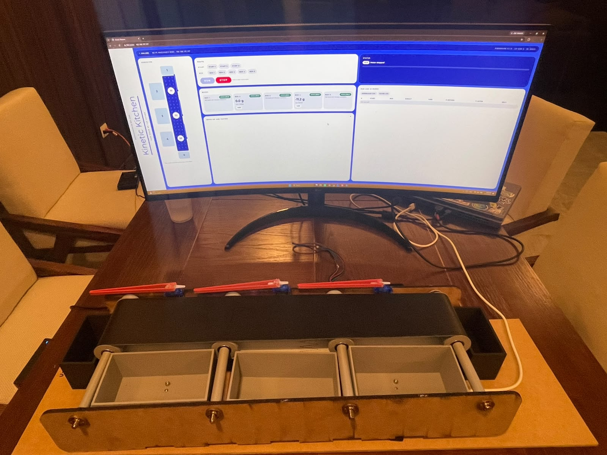
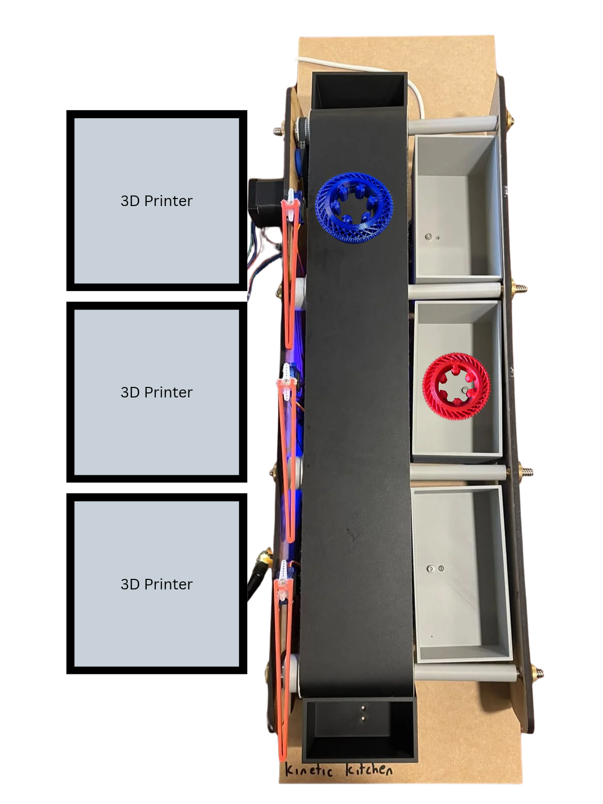
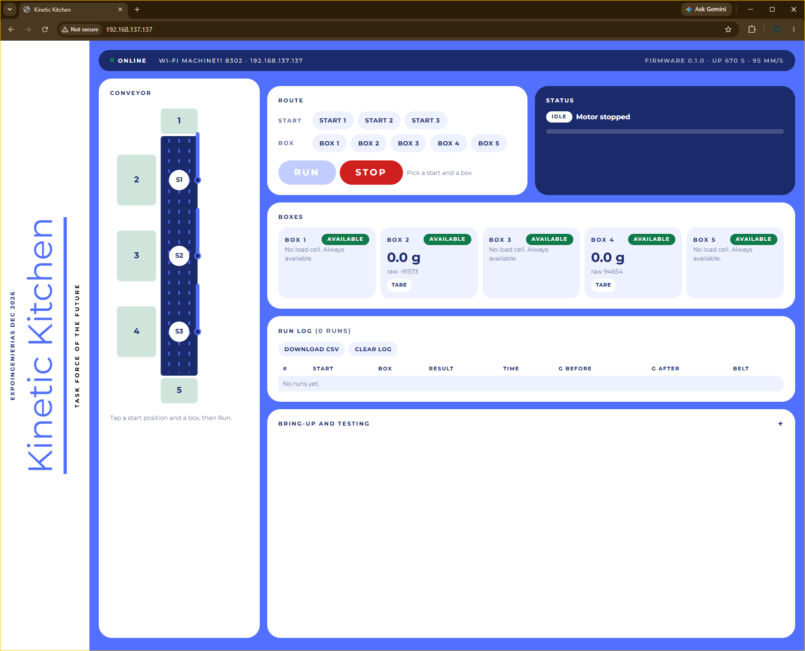
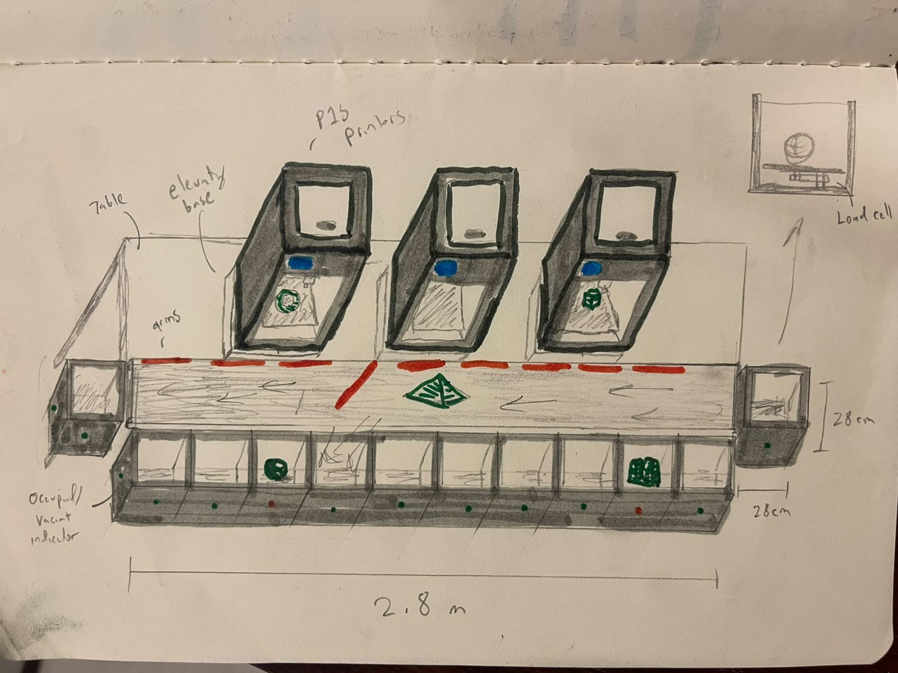

# Kinetic Kitchen

Automated sorting and handoff for 3D print farms. A conveyor in front of a row of
printers sends each finished part to its own box, and load cells show which boxes
are taken. Built in the FrED Factory Lab, Tecnológico de Monterrey, Fall 2026,
for Expo Ingenierías (December 1, 2026).

## Results

The prototype was tested on November 18 and 19, 2026, with 24 printed parts and
252 routing runs.

| Measurement | Target | Result |
| :--- | :--- | :--- |
| Parts delivered to the chosen box | ≥ 98% | 239 of 252 (94.8%). 10 of the 13 failures were parts that reached the right box but did not fit fully inside it. |
| Slowest route | ≤ 8 s | 7.63 s (average 4.0 s) |
| Load cell error against a lab scale | ≤ 5 g | ±2.75 g |
| Box shown as taken after a part lands | Every run | Correct on all 52 recorded runs |
| Heaviest part an arm can push | ≥ 250 g | 250 g on 2 of 3 arms |
| Load the belt can carry | Not set | 1 kg, the only load tried |

With boxes large enough for every part, the estimated success rate is 98.8%.
The full analysis is in [experiments/](experiments/README.md).

## The prototype

* 65 cm × 20 cm × 10 cm conveyor in laser-cut MDF, with 3 start positions (standing in
  for 3 Bambu Lab P1S printers) and 5 collection boxes.
* A NEMA 17 stepper (17HS19-2004S1) and an A4988 driver run a reversible belt through a
  2:1 GT2 timing belt. Boxes 1 and 5 are at the ends of the belt.
* Boxes 2, 3 and 4 are along the side. An SG90 servo arm swings out to 65° and pushes
  the part off the belt into the box.
* Boxes 2 and 4 sit on 1 kg load cells (HX711) and show occupied or vacant from weight.
* An ESP32 (NodeMCU-32S) runs the routes and serves a web dashboard. The dashboard
  picks a start and a box, shows the belt and boxes live, logs every run with a CSV
  download, and has bring-up tools for calibration.
* Parts list at list price: 2,935 MXN (about $147 USD).

## What is in this repository

| Path | What it is |
| :--- | :--- |
| [KineticKitchen_Report.md](KineticKitchen_Report.md) | Project report: problem, design and calculations, build, test results, improvement plan, and the full station plan |
| [experiments/](experiments/README.md) | Test data (252 runs, 24 parts), experiment design and statistical analysis, charts |
| [firmware/Kinetic_Kitchen/](firmware/Kinetic_Kitchen/README.md) | ESP32 firmware (ESP-IDF v6.1) and the dashboard: pin map, build and flash, HTTP API |
| [figures/](figures) | Photos, circuit diagram, layouts and sketches used in the report |

## Full station (planned)

The prototype proves the routing. The planned full station sits in front of three
P1S printers running B.L.A.Z.E. (automatic part removal): a 2.8 m conveyor with a
30 cm belt, 12 boxes each on a load cell, and a message to the student with the box
number when their print arrives.

## Team

Cecil Yusei Howell (project manager), Carlos Alberto Garcia Leyva, Yoana Montoya
Garza and Javier Taddeus Hernández Garza. Advisor: Dr. Erick Ramírez-Cedillo.
FrED Factory project lead: Bárbara Alejandra Novau Martínez.
